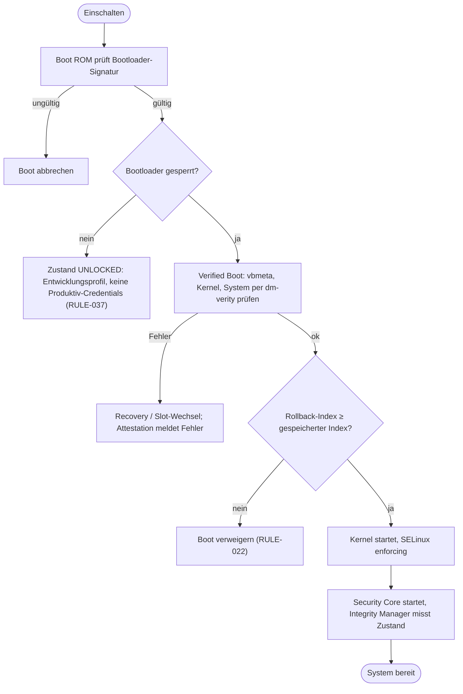
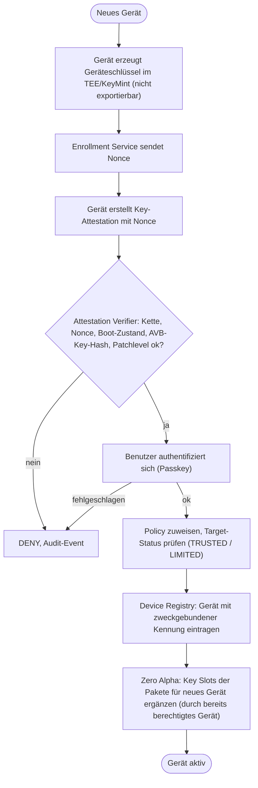
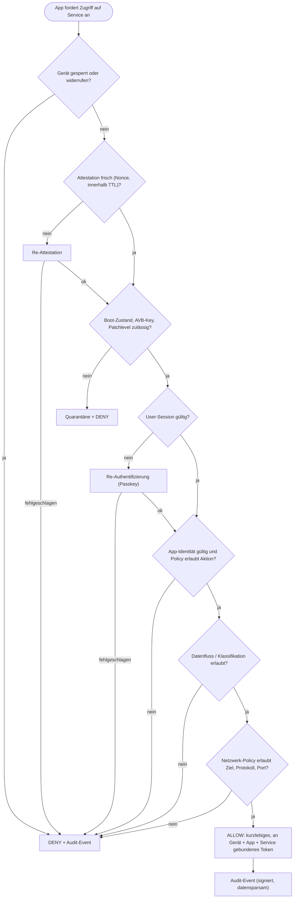
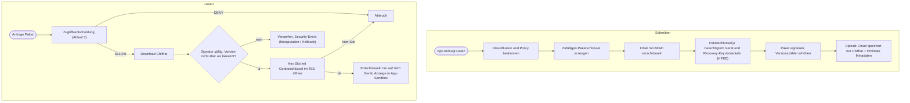
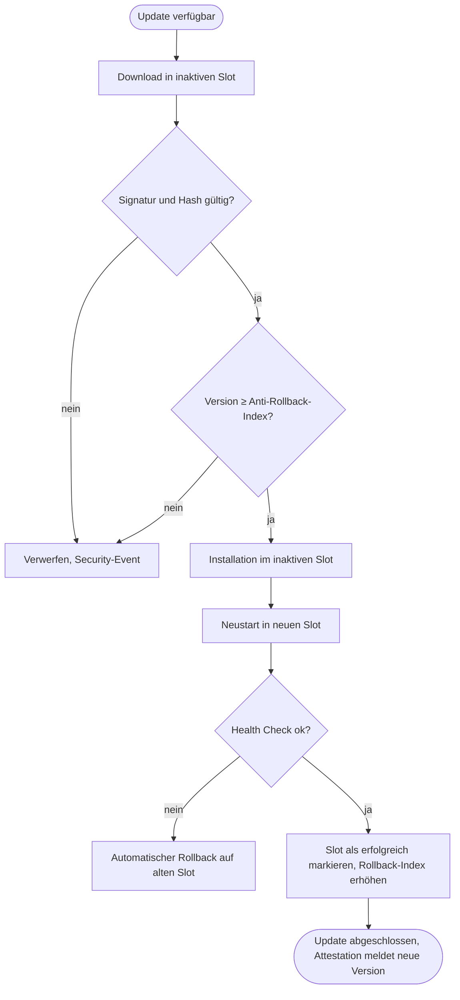
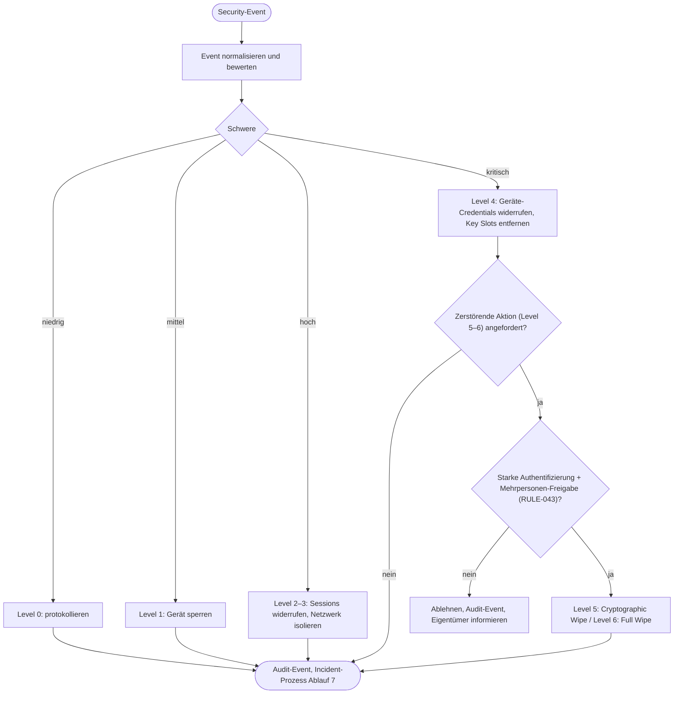
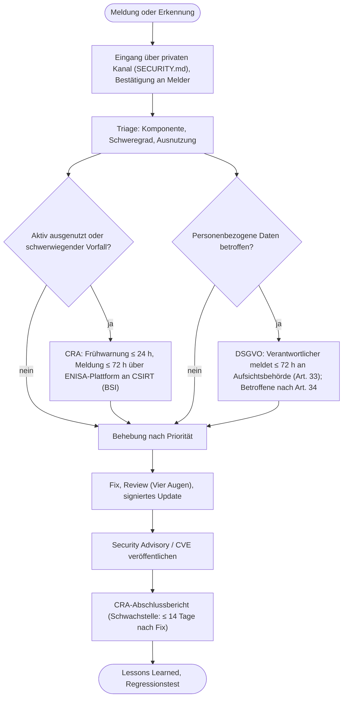
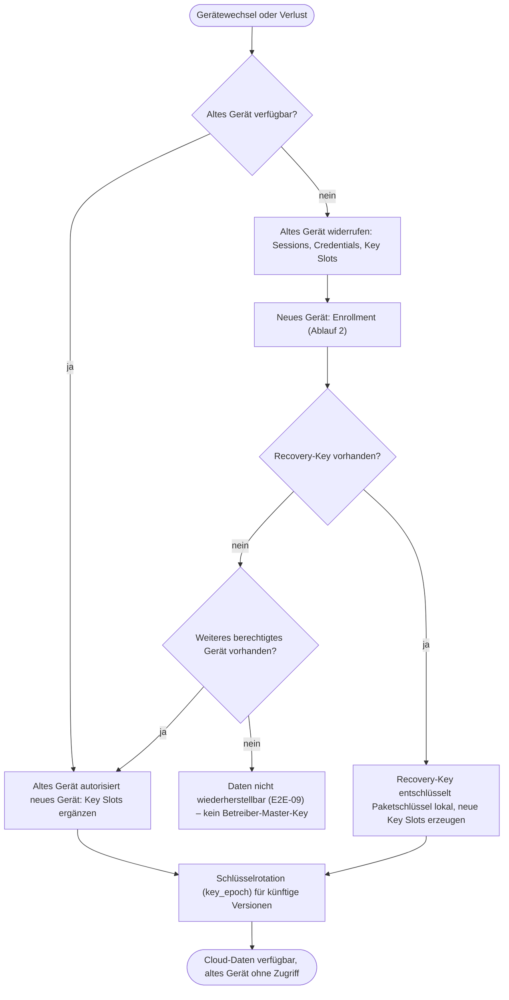

# IPOS / Omega-Zero – Programmablaufpläne

Status: DRAFT
Die Diagramme sind in Mermaid geschrieben und werden auf GitHub direkt dargestellt.

Grundregel für alle Abläufe (RULE-017, Fail Closed): **Jeder unbekannte, ungültige, fehlende, abgelaufene oder widerrufene Zustand führt zu DENY.** Jede sicherheitsrelevante Entscheidung erzeugt ein datensparsames Audit-Event (RULE-029).

## Übersicht

| # | Ablauf | Module |
|---|---|---|
| 1 | Secure Boot / Verified Boot | D-01, P-16 |
| 2 | Geräteregistrierung (Enrollment) | P-21, C-09, C-02 |
| 3 | Zugriffsentscheidung (Zero Trust) | P-01–P-09, C-03, C-04 |
| 4 | Zero Alpha – Paket schreiben und lesen | Z-01–Z-05 |
| 5 | Update (A/B) | P-15 |
| 6 | Security Response / Notfall | P-11, P-12, C-06 |
| 7 | Schwachstellen- und Vorfallmeldung (CRA/DSGVO) | Prozess |
| 8 | Gerätewechsel und Recovery | P-13, Z-06, C-10 |

---

## 1. Secure Boot / Verified Boot

## 2. Geräteregistrierung (Enrollment)

## 3. Zugriffsentscheidung (Zero Trust)

## 4. Zero Alpha – Paket schreiben und lesen

## 5. Update (A/B)

## 6. Security Response / Notfall

## 7. Schwachstellen- und Vorfallmeldung (CRA / DSGVO)

## 8. Gerätewechsel und Recovery

